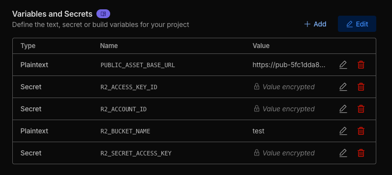

# cobre.photos

My photography portfolio

## Contact

- [Email](mailto:cooper@cobre.photos)
- [Instagram](https://instagram.com/cobre.photos)

## Credit
This site is based off of [pbsv.photo](https://pbsv.photo), the portfolio site of a photographer friend. He graciously allowed me to fork [his code](https://github.com/pbossev/pbsv.photo/) and use it for myself. Thanks!

## Environment

Copy `.env.example` to `.env` and fill in your Cloudflare R2 credentials plus the public base URL for image assets:

```
PUBLIC_ASSET_BASE_URL=https://cdn.example.com
R2_ACCOUNT_ID=...
R2_ACCESS_KEY_ID=...
R2_SECRET_ACCESS_KEY=...
R2_BUCKET_NAME=...
R2_UPLOADS_DIR=uploads
```

`PUBLIC_ASSET_BASE_URL` is used at build time so Eleventy points to the R2 bucket instead of local files. When omitted the build falls back to `/content/...`, which only works if images still live in the repository.

If you're deploying to Cloudflare Pages like I am, you'll also need to add all of those variables except for `R2_UPLOADS_DIR` to your Cloudflare Pages settings


## R2 Workflow

1. Stage new images inside `R2_UPLOADS_DIR/<type>/<folder>/` where `<type>` is `events` or `portfolio` and `<folder>` matches the entry in `src/content/meta.json`. You only need to include the files you want to add—previous images stay in R2.
2. Run `npm run sync:r2` (or `node src/scripts/sync-r2.js`). The script will:
   - Upload originals that are missing in R2.
   - Generate and upload previews when they are absent.
   - Update `src/content/gallery-manifest.json` with width, height, and file info so the site builds without requiring local originals.
3. Commit the updated manifest and metadata changes. The images themselves stay out of git.

> [!TIP]
> Use `--dry-run` to check what would be uploaded before actually syncing, and `--type/--folder` to narrow down a run:
> ```
> npm run sync:r2 -- --dry-run --type events --folder 2025.10.17-wings-over-north-georgia
> ```

If you keep your upload staging area elsewhere, set `R2_UPLOADS_DIR` in `.env` (e.g. `R2_UPLOADS_DIR=./cobre.dev/uploads`) so the sync script picks it up automatically.

If you still have the full local catalog, you can backfill the manifest once with:

```
npm run build:manifest
```

After the manifest exists you can safely delete the local `src/content/events` and `src/content/portfolio` images from git—the build uses the manifest instead.

## Photo source ledger

The WebP files in R2 have their EXIF/XMP stripped by sharp, so they can't be traced back to Lightroom. To avoid keeping a local copy of every original, `src/content/photo-sources.json` records where each site photo came from. It's committed to git and keyed the same way as the manifest, `<type>/<folder>/<webp filename>`:

```json
"events/2025.10.17-wings-over-north-georgia/wong-20251017-001.webp": {
  "rawFileName": "DSC_4821.NEF",
  "captureTime": "2025-10-17T14:03:22.45-04:00",
  "camera": "NIKON Z 8",
  "serial": "6012345",
  "lens": "NIKKOR Z 100-400mm f/4.5-5.6 VR S",
  "documentId": "xmp.did:...",
  "exportedAs": "wong-20251017-001.jpg",
  "recordedAt": "2026-11-19"
}
```

Fields Lightroom didn't embed are left out, and GPS is never read. Export filenames can be anything (including bare sequence numbers), so `rawFileName` (`crs:RawFileName`) is what identifies the photo. In Lightroom, export with **Metadata → Include: All Metadata** or these fields won't be there.

- `npm run sync:r2` records an entry for every staged file that doesn't have one yet, including files that were already uploaded. It lists anything missing Lightroom metadata at the end. Nothing is written under `--dry-run`.
- **Removing a photo from `gallery-manifest.json` removes its source entry** on the next `npm run sync:r2` or `npm run sources:report`, so the two files always list the same photos. The removed keys are printed. Removed entries can still be recovered from git history (`git log -p -- src/content/photo-sources.json`).
- Pruning is skipped, with a warning, if the manifest is missing, empty, or can't be parsed, or if it would remove more than half of the ledger. If you really mean it, add `--force-prune`.

### Backfilling from old exports

Before deleting a folder of past exports (I had ~20 GB), point the backfill at it:

```
npm run sources:backfill -- --dir /path/to/old-exports --dry-run   # preview
npm run sources:backfill -- --dir /path/to/old-exports
npm run sources:report
```

The folder is scanned recursively (`_preview` files are skipped) and each file is matched to a manifest entry by filename stem. If several galleries share a stem, the file's parent `<type>/<folder>` directories decide; if they don't settle it, the file is reported as ambiguous rather than guessed, so move it under a matching directory and re-run.

Files whose name matches nothing are then compared with the weak entries by Lightroom metadata instead: the document ID for the master photo, or failing that the exact capture time (to the sub-second) on the same camera. So to fix a weak entry, find the photo in Lightroom, export it with **Include: All Metadata** under any filename, and point the backfill at that folder. Weak entries are always re-read; add `--overwrite` to also re-read entries that are already fine. An entry that traces to a raw file is never replaced by one that doesn't.

Portfolio photos made from an event export that was imported back into Lightroom have a JPEG as their "raw" filename. When the same photo is also in an event gallery, the backfill copies the event entry's raw filename across.

`rawFileName` comes from `crs:RawFileName`, or `xmpMM:PreservedFileName` when Lightroom left the former out.

`sources:report` shows how many site photos trace back to a raw file (NEF, DNG, ...), how many have a weak entry (a JPEG/TIFF "raw" filename, no `rawFileName` so only findable by capture time, or no Lightroom metadata at all), and how many have no entry, and lists the last two groups. Only when both lists are empty does it say it's safe to delete the local originals. Until then, keep them.

### Finding a photo later

Look up the photo's key in `src/content/photo-sources.json`, then in Lightroom's Library Filter choose **Text → Filename** and search for its `rawFileName` (e.g. `DSC_4821`). If there's no `rawFileName`, filter by **Metadata → Date** using `captureTime` (and camera/lens) instead.

## Local previews

When you want to check a batch of images locally (either in `src/content/...` or your staged upload directory) you can generate the matching `_preview.webp` files without touching R2:

```
npm run previews:local
```

By default the script looks in the directory defined by `R2_UPLOADS_DIR` (falls back to `uploads`). Use flags to target specific folders:

```
npm run previews:local -- --dir src/content --type portfolio --folder aviation
```

Add `--force` when you need to regenerate previews even if the `.webp` already exists.

## Custom image order

If you want tighter control over how photos appear inside a gallery, add an `image_order`
array to the corresponding entry in `src/content/meta.json`. List filenames (including
extensions) in your desired sequence:

```json
{
  "title": "Aviation Highlights",
  "folder": "aviation",
  "image_order": [
    "DSC_1906.webp",
    "cobre.photos-0811-1014-4.webp",
    "DSC_0228.webp"
  ]
}
```

Any files you omit fall back to their existing order after the ones you list. The same
property works for event galleries as well.
